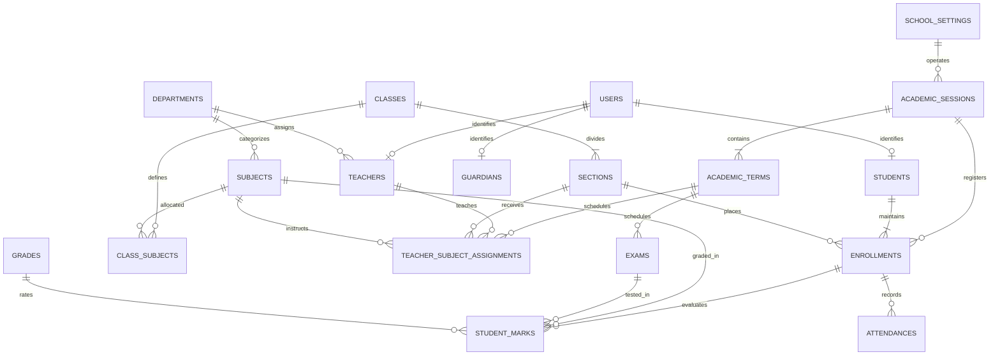

# System Specification & Architecture Document: Core Academics & People Engine (MVP)

**Project:** White-Label School Management System (SMS) Modernization (Laravel 11 + Vue 3)  
**Distribution Model:** Turnkey Single-Tenant Instance-per-Client for Shared Hosting (cPanel/LiteSpeed)  
**Reference Benchmark:** Government Science Academy / Secondary School (GSSS), Gusau  
**Scope:** Core Academics & People Modules (MVP)  
**Document Version:** 1.1.0  
**Author:** AI Systems Architect & Engineering Team  
**Date:** October 2026

---

## 1. Executive Summary & Product Architecture

The objective of this project is to build a commercial, lightweight, white-label **School Management System (SMS)** engineered with **Laravel 11** and **Vue 3** that can be rapidly deployed and sold to multiple school clients on standard **shared hosting environments (cPanel, LiteSpeed, DirectAdmin)**.

The initial reference database benchmark is derived from a production CodeIgniter 3 system (`sms.sql`). The forensic audit of this database revealed acute structural issues, missing relational integrity, and massive table bloat.

### 1.1 Commercial Distribution Model (Instance-per-School)

The application follows a **Turnkey Single-Tenant Distribution Model**:

- **Complete Data Isolation:** Each client school gets its own isolated database and web instance. School A can never access or compromise School B's student or exam records.
- **Shared Hosting Ready:** Runs smoothly on cheap, ubiquitous shared hosting plans without requiring Docker, Kubernetes, VPS root access, or Node.js on the production server.
- **Rapid Turnkey Onboarding:** When a new client school purchases the software, the operator simply clones/copies the repository, sets up a fresh database in cPanel, runs a single-step setup command (or web wizard), and hands over a fully branded portal within 2 minutes.
- **100% Dynamic White-Labeling:** Zero hardcoded school names or branding. Every school badge, motto, grading threshold, term schedule, and color accent is configurable via the institutional profile.

### 1.2 MVP Scope Definition

This initial release focuses **exclusively on the Active Core Academics and People** domain. All ancillary and unpopulated modules from the legacy system (e.g., Library, Invoices/Fees, CMS Public Website, Timetable Routines, and Expenses) are intentionally scoped out of this MVP and deferred to future phases.

### Core Modules Included in MVP:

1. **People & Identity Management:** Users, Roles/Permissions, Staff/Teachers, Students, and Guardians.
2. **Academic Hierarchy:** Academic Sessions (Years), Academic Terms, Departments, Classes, and Sections.
3. **Enrollment Engine:** Session-based Student Enrollments and Class/Section assignments.
4. **Curriculum & Subject Allocation:** Normalized Master Subject Catalog, Class Curriculum, and Teacher Subject Assignments.
5. **Continuous Assessment & Examination Engine:** CA1, CA2, CA3, Exam scores, Automated Grading Scales, and Performance Analytics.
6. **Attendance Tracking:** Daily attendance recording with section-level batch processing.
7. **Institutional White-Label Profile:** Central institutional configuration (name, motto, logo, accreditation, signatures).
8. **Automated Onboarding & Installer:** Turnkey setup wizard for instant client deployment on shared hosts.

---

## 2. Legacy System Forensic Audit & Integrity Analysis

The benchmark database (`sms.sql`) contains **38 tables**. However, an empirical count revealed that over 65% of these tables were completely unpopulated (0 rows) or contained framework artifacts.

### 2.1 Table Categorization & MVP Disposition

| Legacy Table                     | Old Row Count | MVP Status              | Disposition & Rationale                                                                                                                                                         |
| :------------------------------- | :------------ | :---------------------- | :------------------------------------------------------------------------------------------------------------------------------------------------------------------------------ |
| `users`                          | 1,877         | **MIGRATE & REFACTOR**  | Core identity table. Contains 1 superadmin, 19 admins, 24 teachers, and 1,840 students. Needs password re-hashing and credential normalization.                                 |
| `students`                       | 1,842         | **MIGRATE & REFACTOR**  | Core student profiles. Foreign keys to `users` and `parents` must be strictly enforced.                                                                                         |
| `teachers`                       | 20            | **MIGRATE & REFACTOR**  | Core academic staff profiles. Move to clean 1-to-1 relationship with `users`.                                                                                                   |
| `classes`                        | 6             | **MIGRATE & REFACTOR**  | Secondary levels: JSS 1 to SS 3.                                                                                                                                                |
| `sections`                       | 24            | **MIGRATE & REFACTOR**  | Arms A, B, C, D across the 6 classes.                                                                                                                                           |
| `departments`                    | 10            | **MIGRATE & REFACTOR**  | Academic departments (Science, Arts, Languages, etc.).                                                                                                                          |
| `subjects`                       | 57            | **MIGRATE & NORMALIZE** | Highly redundant in legacy (e.g., Mathematics repeated for every single class). Needs normalization into a master subject catalog.                                              |
| `sessions`                       | 2             | **RE-ARCHITECT**        | Flawed schema where academic year ('2025/2026') and term ('Second term') were conflated into one column. Split into `academic_sessions` and `academic_terms`.                   |
| `enrols`                         | 1,837         | **MIGRATE & REFACTOR**  | Maps students to classes/sections per session. Enforce unique index on `(student_id, session_id)`.                                                                              |
| `marks`                          | 25,906        | **FILTER & MIGRATE**    | 25,660 rows are blank zero-placeholders created by CodeIgniter auto-insert scripts. Only **246 rows** contain genuine academic marks. Migrate genuine rows; discard zero bloat. |
| `grades`                         | 6             | **MIGRATE & REFACTOR**  | Standard grading scale (A: 70–100, B: 60–69, C: 50–59, D: 40–49, E: 35–39, F: 0–34).                                                                                            |
| `exams`                          | 3             | **MIGRATE & REFACTOR**  | First, Second, Third Term assessment milestones. Relate properly to `academic_terms`.                                                                                           |
| `daily_attendances`              | 2,499         | **MIGRATE & REFACTOR**  | 1,220 genuine student attendance records across 18 dates. Replace Unix integer timestamps with proper SQL `DATE` fields.                                                        |
| `teacher_permissions`            | 19            | **REPLACE**             | Replace ad-hoc boolean columns with standard RBAC and Subject Allocation pivots.                                                                                                |
| `schools`, `settings`            | 1 each        | **CONSOLIDATE**         | Single institution context. Consolidate into `school_settings`.                                                                                                                 |
| `invoices`                       | 66            | **DEFERRED (Phase 2)**  | PTA fee records. Scoped out of MVP per focus instructions.                                                                                                                      |
| `parents`                        | 1             | **RE-ARCHITECT**        | Legacy table had only 1 row while students had random foreign keys (0 and 1). Redesign cleanly for future parent portal onboarding.                                             |
| `routines`                       | 3             | **DEFERRED (Phase 2)**  | Timetable entries. Only 3 broken test entries; deferred.                                                                                                                        |
| `books`, `book_issues`           | 0             | **DROP**                | Library module unused.                                                                                                                                                          |
| `expenses`, `expense_categories` | 0             | **DROP**                | Accounting module unused.                                                                                                                                                       |
| `syllabuses`, `addons`           | 0             | **DROP**                | Unused modules.                                                                                                                                                                 |
| `frontend_*` (5 tables)          | 0–1           | **DROP**                | CodeIgniter public CMS website tables. Not relevant to internal SMS.                                                                                                            |
| `ci_sessions`                    | 277           | **DROP**                | CodeIgniter 3 session cache. Replaced by Laravel session driver.                                                                                                                |
| `menus`                          | 58            | **DROP**                | CodeIgniter hardcoded navigation records. Replaced by Vue route declarations.                                                                                                   |
| `currencies`                     | 112           | **DROP**                | Replaced by single configurable institutional currency (default: NGN / ₦).                                                                                                      |

---

### 2.2 Critical Data Integrity Flaws in Legacy Database

> [!WARNING]
> These structural bugs caused recurring data corruption in the legacy system and must be strictly resolved in the new schema:

1. **Complete Absence of Foreign Key Constraints:**
    - In the legacy dump, not a single foreign key exists. Deleting a record left orphaned children throughout `marks`, `enrols`, and `daily_attendances`.
    - `students.parent_id` frequently references `0` or `1`, even though `parents` table only had a record with ID `2`.
2. **Identity & Identifier Ambiguity:**
    - In `enrols` and `marks`, the column `student_id` actually contains `users.id` in some queries and `students.id` in others.
    - Admission numbers (e.g., `GSSS25-00001`) were crammed into the `email` column because CodeIgniter's user table required an email string.
3. **Conflation of Sessions and Terms:**
    - Legacy `sessions` table mixed two orthogonal concepts: Row 1 was `2025/2026` (Academic Year), while Row 2 was `Second term` (Academic Term). This made historical tracking across multiple terms within the same year impossible without data corruption.
4. **Data Type Mismatches & Broken Dates:**
    - Dates were stored arbitrarily as Unix timestamps (`1768777200`), malformed date strings (`10/28/2024 00:00:1`), or integer epochs.
    - In `routines`, integer time values (`starting_hour`, `ending_minute`) were stored as `varchar(255)`.
    - In `enrols`, `session` was a `varchar(255)` string (`'3'`), whereas in `marks` it was an `int(11)`.
5. **Security Vulnerabilities:**
    - Legacy passwords used un-salted SHA-1 (`7c222fb29...`). All credentials must be upgraded to **Bcrypt / Argon2id**.

---

## 3. Technology Architecture & Stack

```
┌────────────────────────────────────────────────────────┐
│                   CLIENT BROWSER                       │
│     Vue 3 (Composition API, Pinia, Inertia.js / SPA)    │
└───────────────────────────▲────────────────────────────┘
                            │  Inertia JSON / State
┌───────────────────────────▼────────────────────────────┐
│                  LARAVEL 11 BACKEND                    │
│   Auth (Sanctum/Session)  │  Form Requests & Policies  │
│   Services & Action Layer │  Eloquent ORM Models       │
└───────────────────────────▲────────────────────────────┘
                            │  Strict Relational Queries
┌───────────────────────────▼────────────────────────────┐
│                 MYSQL 8.0+ DATABASE                     │
│  InnoDB Engine │ Foreign Keys │ Unique & Composite IDX │
└────────────────────────────────────────────────────────┘
```

- **Backend Framework:** Laravel 11.x on PHP 8.2 / 8.3.
- **Frontend Framework:** Vue 3 (Composition API with `<script setup>`).
- **Glue / Adapter:** **Inertia.js** (delivers modern SPA user experience with monolithic velocity, eliminates double-declaration of REST API endpoints while maintaining full client-side reactivity).
- **State & Data Tables:** Pinia for client state; custom reactive tables for high-performance mark entry grids.
- **Database Engine:** MySQL 8.0+ / MariaDB 10.11+ using `InnoDB` and `utf8mb4_unicode_ci`.
- **Shared Hosting Engine Compatibility:** Standard Apache and LiteSpeed web servers.

---

## 4. Normalized Relational Schema Specification

### 4.1 Entity Relationship Diagram (ERD)



---

### 4.2 Data DDL Specifications (Core Tables)

#### 1. `school_settings`

Dynamic white-label institutional configuration for the deployed instance.

```sql
CREATE TABLE `school_settings` (
    `id` BIGINT UNSIGNED AUTO_INCREMENT PRIMARY KEY,
    `school_name` VARCHAR(255) NOT NULL DEFAULT 'School Management System',
    `school_code` VARCHAR(50) NOT NULL DEFAULT 'SMS-APP',
    `motto` VARCHAR(255) NULL,
    `address` TEXT NULL,
    `phone` VARCHAR(50) NULL,
    `email` VARCHAR(150) NULL,
    `currency_symbol` VARCHAR(10) NOT NULL DEFAULT '₦',
    `currency_code` VARCHAR(10) NOT NULL DEFAULT 'NGN',
    `principal_name` VARCHAR(255) NULL,
    `logo_path` VARCHAR(255) NULL,
    `stamp_path` VARCHAR(255) NULL,
    `created_at` TIMESTAMP NULL DEFAULT CURRENT_TIMESTAMP,
    `updated_at` TIMESTAMP NULL DEFAULT CURRENT_TIMESTAMP ON UPDATE CURRENT_TIMESTAMP
) ENGINE=InnoDB DEFAULT CHARSET=utf8mb4 COLLATE=utf8mb4_unicode_ci;
```

#### 2. `users`

Global authentication table with multi-role support.

```sql
CREATE TABLE `users` (
    `id` BIGINT UNSIGNED AUTO_INCREMENT PRIMARY KEY,
    `username` VARCHAR(100) NOT NULL UNIQUE COMMENT 'Admission No for students, Staff ID for teachers, or Admin username',
    `email` VARCHAR(150) NULL UNIQUE,
    `password` VARCHAR(255) NOT NULL,
    `first_name` VARCHAR(100) NOT NULL,
    `middle_name` VARCHAR(100) NULL,
    `last_name` VARCHAR(100) NOT NULL,
    `role` ENUM('superadmin', 'admin', 'exam_officer', 'teacher', 'student', 'guardian') NOT NULL DEFAULT 'student',
    `gender` ENUM('male', 'female') NOT NULL DEFAULT 'male',
    `phone` VARCHAR(30) NULL,
    `blood_group` VARCHAR(10) NULL,
    `address` TEXT NULL,
    `avatar` VARCHAR(255) NULL,
    `is_active` BOOLEAN NOT NULL DEFAULT TRUE,
    `legacy_id` INT UNSIGNED NULL COMMENT 'Mapping back to old CodeIgniter users.id if migrated',
    `remember_token` VARCHAR(100) NULL,
    `created_at` TIMESTAMP NULL DEFAULT CURRENT_TIMESTAMP,
    `updated_at` TIMESTAMP NULL DEFAULT CURRENT_TIMESTAMP ON UPDATE CURRENT_TIMESTAMP,
    INDEX `idx_users_role` (`role`),
    INDEX `idx_users_username` (`username`)
) ENGINE=InnoDB DEFAULT CHARSET=utf8mb4 COLLATE=utf8mb4_unicode_ci;
```

#### 3. `academic_sessions` & `academic_terms`

Strict separation of Academic Years and Terms.

```sql
CREATE TABLE `academic_sessions` (
    `id` BIGINT UNSIGNED AUTO_INCREMENT PRIMARY KEY,
    `name` VARCHAR(50) NOT NULL UNIQUE COMMENT 'e.g., 2024/2025, 2025/2026',
    `start_date` DATE NOT NULL,
    `end_date` DATE NOT NULL,
    `is_current` BOOLEAN NOT NULL DEFAULT FALSE,
    `created_at` TIMESTAMP NULL DEFAULT CURRENT_TIMESTAMP,
    `updated_at` TIMESTAMP NULL DEFAULT CURRENT_TIMESTAMP ON UPDATE CURRENT_TIMESTAMP
) ENGINE=InnoDB DEFAULT CHARSET=utf8mb4 COLLATE=utf8mb4_unicode_ci;

CREATE TABLE `academic_terms` (
    `id` BIGINT UNSIGNED AUTO_INCREMENT PRIMARY KEY,
    `academic_session_id` BIGINT UNSIGNED NOT NULL,
    `name` VARCHAR(50) NOT NULL COMMENT 'First Term, Second Term, Third Term',
    `term_number` TINYINT UNSIGNED NOT NULL COMMENT '1, 2, or 3',
    `start_date` DATE NOT NULL,
    `end_date` DATE NOT NULL,
    `is_current` BOOLEAN NOT NULL DEFAULT FALSE,
    `created_at` TIMESTAMP NULL DEFAULT CURRENT_TIMESTAMP,
    `updated_at` TIMESTAMP NULL DEFAULT CURRENT_TIMESTAMP ON UPDATE CURRENT_TIMESTAMP,
    FOREIGN KEY (`academic_session_id`) REFERENCES `academic_sessions`(`id`) ON DELETE CASCADE,
    UNIQUE KEY `unique_term_per_session` (`academic_session_id`, `term_number`)
) ENGINE=InnoDB DEFAULT CHARSET=utf8mb4 COLLATE=utf8mb4_unicode_ci;
```

#### 4. `departments`, `classes`, and `sections`

Academic structure with clean foreign keys.

```sql
CREATE TABLE `departments` (
    `id` BIGINT UNSIGNED AUTO_INCREMENT PRIMARY KEY,
    `name` VARCHAR(100) NOT NULL UNIQUE COMMENT 'Sciences, Arts & Humanities, Languages, etc.',
    `description` VARCHAR(255) NULL,
    `created_at` TIMESTAMP NULL DEFAULT CURRENT_TIMESTAMP,
    `updated_at` TIMESTAMP NULL DEFAULT CURRENT_TIMESTAMP ON UPDATE CURRENT_TIMESTAMP
) ENGINE=InnoDB DEFAULT CHARSET=utf8mb4 COLLATE=utf8mb4_unicode_ci;

CREATE TABLE `classes` (
    `id` BIGINT UNSIGNED AUTO_INCREMENT PRIMARY KEY,
    `name` VARCHAR(50) NOT NULL UNIQUE COMMENT 'JSS 1, JSS 2, JSS 3, SS 1, SS 2, SS 3',
    `level_order` TINYINT UNSIGNED NOT NULL COMMENT '1 for JSS 1 up to 6 for SS 3 for auto-promotion',
    `stage` ENUM('junior_secondary', 'senior_secondary') NOT NULL,
    `created_at` TIMESTAMP NULL DEFAULT CURRENT_TIMESTAMP,
    `updated_at` TIMESTAMP NULL DEFAULT CURRENT_TIMESTAMP ON UPDATE CURRENT_TIMESTAMP
) ENGINE=InnoDB DEFAULT CHARSET=utf8mb4 COLLATE=utf8mb4_unicode_ci;

CREATE TABLE `sections` (
    `id` BIGINT UNSIGNED AUTO_INCREMENT PRIMARY KEY,
    `class_id` BIGINT UNSIGNED NOT NULL,
    `name` VARCHAR(50) NOT NULL COMMENT 'A, B, C, D, etc.',
    `capacity` SMALLINT UNSIGNED NOT NULL DEFAULT 60,
    `created_at` TIMESTAMP NULL DEFAULT CURRENT_TIMESTAMP,
    `updated_at` TIMESTAMP NULL DEFAULT CURRENT_TIMESTAMP ON UPDATE CURRENT_TIMESTAMP,
    FOREIGN KEY (`class_id`) REFERENCES `classes`(`id`) ON DELETE CASCADE,
    UNIQUE KEY `unique_class_section` (`class_id`, `name`)
) ENGINE=InnoDB DEFAULT CHARSET=utf8mb4 COLLATE=utf8mb4_unicode_ci;
```

#### 5. `subjects` & `class_subjects`

Normalized subject catalog.

```sql
CREATE TABLE `subjects` (
    `id` BIGINT UNSIGNED AUTO_INCREMENT PRIMARY KEY,
    `department_id` BIGINT UNSIGNED NULL,
    `code` VARCHAR(20) NOT NULL UNIQUE COMMENT 'e.g., MTH, ENG, PHY, CHM, BIO, HAUS',
    `name` VARCHAR(150) NOT NULL UNIQUE COMMENT 'Mathematics, English Language, Physics, etc.',
    `is_elective` BOOLEAN NOT NULL DEFAULT FALSE,
    `created_at` TIMESTAMP NULL DEFAULT CURRENT_TIMESTAMP,
    `updated_at` TIMESTAMP NULL DEFAULT CURRENT_TIMESTAMP ON UPDATE CURRENT_TIMESTAMP,
    FOREIGN KEY (`department_id`) REFERENCES `departments`(`id`) ON DELETE SET NULL
) ENGINE=InnoDB DEFAULT CHARSET=utf8mb4 COLLATE=utf8mb4_unicode_ci;

CREATE TABLE `class_subjects` (
    `id` BIGINT UNSIGNED AUTO_INCREMENT PRIMARY KEY,
    `class_id` BIGINT UNSIGNED NOT NULL,
    `subject_id` BIGINT UNSIGNED NOT NULL,
    `is_compulsory` BOOLEAN NOT NULL DEFAULT TRUE,
    FOREIGN KEY (`class_id`) REFERENCES `classes`(`id`) ON DELETE CASCADE,
    FOREIGN KEY (`subject_id`) REFERENCES `subjects`(`id`) ON DELETE CASCADE,
    UNIQUE KEY `unique_class_subject` (`class_id`, `subject_id`)
) ENGINE=InnoDB DEFAULT CHARSET=utf8mb4 COLLATE=utf8mb4_unicode_ci;
```

#### 6. `students`, `teachers`, and `guardians`

Detailed profiles linked 1-to-1 with `users`.

```sql
CREATE TABLE `guardians` (
    `id` BIGINT UNSIGNED AUTO_INCREMENT PRIMARY KEY,
    `user_id` BIGINT UNSIGNED NULL UNIQUE,
    `name` VARCHAR(200) NOT NULL,
    `relationship` VARCHAR(50) NOT NULL DEFAULT 'Parent',
    `phone` VARCHAR(30) NOT NULL,
    `email` VARCHAR(150) NULL,
    `address` TEXT NULL,
    `occupation` VARCHAR(150) NULL,
    `created_at` TIMESTAMP NULL DEFAULT CURRENT_TIMESTAMP,
    `updated_at` TIMESTAMP NULL DEFAULT CURRENT_TIMESTAMP ON UPDATE CURRENT_TIMESTAMP,
    FOREIGN KEY (`user_id`) REFERENCES `users`(`id`) ON DELETE SET NULL
) ENGINE=InnoDB DEFAULT CHARSET=utf8mb4 COLLATE=utf8mb4_unicode_ci;

CREATE TABLE `students` (
    `id` BIGINT UNSIGNED AUTO_INCREMENT PRIMARY KEY,
    `user_id` BIGINT UNSIGNED NOT NULL UNIQUE,
    `guardian_id` BIGINT UNSIGNED NULL,
    `admission_number` VARCHAR(50) NOT NULL UNIQUE COMMENT 'e.g. GSSS25-00001',
    `admission_date` DATE NOT NULL,
    `date_of_birth` DATE NULL,
    `state_of_origin` VARCHAR(100) NULL,
    `lga` VARCHAR(100) NULL,
    `created_at` TIMESTAMP NULL DEFAULT CURRENT_TIMESTAMP,
    `updated_at` TIMESTAMP NULL DEFAULT CURRENT_TIMESTAMP ON UPDATE CURRENT_TIMESTAMP,
    FOREIGN KEY (`user_id`) REFERENCES `users`(`id`) ON DELETE CASCADE,
    FOREIGN KEY (`guardian_id`) REFERENCES `guardians`(`id`) ON DELETE SET NULL
) ENGINE=InnoDB DEFAULT CHARSET=utf8mb4 COLLATE=utf8mb4_unicode_ci;

CREATE TABLE `teachers` (
    `id` BIGINT UNSIGNED AUTO_INCREMENT PRIMARY KEY,
    `user_id` BIGINT UNSIGNED NOT NULL UNIQUE,
    `department_id` BIGINT UNSIGNED NULL,
    `staff_id` VARCHAR(50) NOT NULL UNIQUE COMMENT 'Staff ID / Payroll Code',
    `designation` VARCHAR(150) NULL COMMENT 'e.g., Form Master, H.O.D, Senior Master',
    `qualification` VARCHAR(150) NULL COMMENT 'B.Sc. Ed, B.Tech, NCE, etc.',
    `joining_date` DATE NULL,
    `created_at` TIMESTAMP NULL DEFAULT CURRENT_TIMESTAMP,
    `updated_at` TIMESTAMP NULL DEFAULT CURRENT_TIMESTAMP ON UPDATE CURRENT_TIMESTAMP,
    FOREIGN KEY (`user_id`) REFERENCES `users`(`id`) ON DELETE CASCADE,
    FOREIGN KEY (`department_id`) REFERENCES `departments`(`id`) ON DELETE SET NULL
) ENGINE=InnoDB DEFAULT CHARSET=utf8mb4 COLLATE=utf8mb4_unicode_ci;
```

#### 7. `enrollments` & `teacher_subject_assignments`

Core binding tables linking students and staff to sessions, classes, and sections.

```sql
CREATE TABLE `enrollments` (
    `id` BIGINT UNSIGNED AUTO_INCREMENT PRIMARY KEY,
    `student_id` BIGINT UNSIGNED NOT NULL,
    `academic_session_id` BIGINT UNSIGNED NOT NULL,
    `class_id` BIGINT UNSIGNED NOT NULL,
    `section_id` BIGINT UNSIGNED NOT NULL,
    `roll_number` VARCHAR(30) NULL,
    `status` ENUM('active', 'promoted', 'repeated', 'withdrawn', 'graduated') NOT NULL DEFAULT 'active',
    `created_at` TIMESTAMP NULL DEFAULT CURRENT_TIMESTAMP,
    `updated_at` TIMESTAMP NULL DEFAULT CURRENT_TIMESTAMP ON UPDATE CURRENT_TIMESTAMP,
    FOREIGN KEY (`student_id`) REFERENCES `students`(`id`) ON DELETE CASCADE,
    FOREIGN KEY (`academic_session_id`) REFERENCES `academic_sessions`(`id`) ON DELETE CASCADE,
    FOREIGN KEY (`class_id`) REFERENCES `classes`(`id`) ON DELETE RESTRICT,
    FOREIGN KEY (`section_id`) REFERENCES `sections`(`id`) ON DELETE RESTRICT,
    UNIQUE KEY `unique_student_session` (`student_id`, `academic_session_id`),
    INDEX `idx_enrollment_lookup` (`academic_session_id`, `class_id`, `section_id`, `status`)
) ENGINE=InnoDB DEFAULT CHARSET=utf8mb4 COLLATE=utf8mb4_unicode_ci;

CREATE TABLE `teacher_subject_assignments` (
    `id` BIGINT UNSIGNED AUTO_INCREMENT PRIMARY KEY,
    `academic_session_id` BIGINT UNSIGNED NOT NULL,
    `academic_term_id` BIGINT UNSIGNED NOT NULL,
    `teacher_id` BIGINT UNSIGNED NOT NULL,
    `class_id` BIGINT UNSIGNED NOT NULL,
    `section_id` BIGINT UNSIGNED NOT NULL,
    `subject_id` BIGINT UNSIGNED NOT NULL,
    `can_input_marks` BOOLEAN NOT NULL DEFAULT TRUE,
    `can_take_attendance` BOOLEAN NOT NULL DEFAULT FALSE,
    `created_at` TIMESTAMP NULL DEFAULT CURRENT_TIMESTAMP,
    `updated_at` TIMESTAMP NULL DEFAULT CURRENT_TIMESTAMP ON UPDATE CURRENT_TIMESTAMP,
    FOREIGN KEY (`academic_session_id`) REFERENCES `academic_sessions`(`id`) ON DELETE CASCADE,
    FOREIGN KEY (`academic_term_id`) REFERENCES `academic_terms`(`id`) ON DELETE CASCADE,
    FOREIGN KEY (`teacher_id`) REFERENCES `teachers`(`id`) ON DELETE CASCADE,
    FOREIGN KEY (`class_id`) REFERENCES `classes`(`id`) ON DELETE CASCADE,
    FOREIGN KEY (`section_id`) REFERENCES `sections`(`id`) ON DELETE CASCADE,
    FOREIGN KEY (`subject_id`) REFERENCES `subjects`(`id`) ON DELETE CASCADE,
    UNIQUE KEY `unique_assignment` (`academic_term_id`, `section_id`, `subject_id`)
) ENGINE=InnoDB DEFAULT CHARSET=utf8mb4 COLLATE=utf8mb4_unicode_ci;
```

#### 8. `exams`, `grades`, and `student_marks`

Assessment engine matching the Nigerian secondary curriculum (CA1 + CA2 + CA3 + Exam = 100).

```sql
CREATE TABLE `exams` (
    `id` BIGINT UNSIGNED AUTO_INCREMENT PRIMARY KEY,
    `academic_session_id` BIGINT UNSIGNED NOT NULL,
    `academic_term_id` BIGINT UNSIGNED NOT NULL,
    `name` VARCHAR(150) NOT NULL COMMENT 'First Term Examination 2024/2025',
    `max_ca1` DECIMAL(5,2) NOT NULL DEFAULT 10.00,
    `max_ca2` DECIMAL(5,2) NOT NULL DEFAULT 10.00,
    `max_ca3` DECIMAL(5,2) NOT NULL DEFAULT 10.00,
    `max_exam` DECIMAL(5,2) NOT NULL DEFAULT 70.00,
    `is_published` BOOLEAN NOT NULL DEFAULT FALSE,
    `created_at` TIMESTAMP NULL DEFAULT CURRENT_TIMESTAMP,
    `updated_at` TIMESTAMP NULL DEFAULT CURRENT_TIMESTAMP ON UPDATE CURRENT_TIMESTAMP,
    FOREIGN KEY (`academic_session_id`) REFERENCES `academic_sessions`(`id`) ON DELETE CASCADE,
    FOREIGN KEY (`academic_term_id`) REFERENCES `academic_terms`(`id`) ON DELETE CASCADE
) ENGINE=InnoDB DEFAULT CHARSET=utf8mb4 COLLATE=utf8mb4_unicode_ci;

CREATE TABLE `grades` (
    `id` BIGINT UNSIGNED AUTO_INCREMENT PRIMARY KEY,
    `name` VARCHAR(10) NOT NULL COMMENT 'A, B, C, D, E, F',
    `grade_point` DECIMAL(4,2) NOT NULL COMMENT '5.0, 4.0, 3.0, 2.0, 1.0, 0.0',
    `mark_from` DECIMAL(5,2) NOT NULL,
    `mark_to` DECIMAL(5,2) NOT NULL,
    `remark` VARCHAR(50) NOT NULL COMMENT 'Excellent, Very Good, Good, Pass, Fair, Fail',
    `created_at` TIMESTAMP NULL DEFAULT CURRENT_TIMESTAMP,
    `updated_at` TIMESTAMP NULL DEFAULT CURRENT_TIMESTAMP ON UPDATE CURRENT_TIMESTAMP,
    UNIQUE KEY `unique_grade_name` (`name`)
) ENGINE=InnoDB DEFAULT CHARSET=utf8mb4 COLLATE=utf8mb4_unicode_ci;

CREATE TABLE `student_marks` (
    `id` BIGINT UNSIGNED AUTO_INCREMENT PRIMARY KEY,
    `enrollment_id` BIGINT UNSIGNED NOT NULL,
    `subject_id` BIGINT UNSIGNED NOT NULL,
    `exam_id` BIGINT UNSIGNED NOT NULL,
    `ca1` DECIMAL(5,2) NULL DEFAULT 0.00,
    `ca2` DECIMAL(5,2) NULL DEFAULT 0.00,
    `ca3` DECIMAL(5,2) NULL DEFAULT 0.00,
    `exam_score` DECIMAL(5,2) NULL DEFAULT 0.00,
    `total_score` DECIMAL(5,2) GENERATED ALWAYS AS (COALESCE(`ca1`,0) + COALESCE(`ca2`,0) + COALESCE(`ca3`,0) + COALESCE(`exam_score`,0)) STORED,
    `grade_id` BIGINT UNSIGNED NULL,
    `teacher_comment` VARCHAR(255) NULL,
    `created_at` TIMESTAMP NULL DEFAULT CURRENT_TIMESTAMP,
    `updated_at` TIMESTAMP NULL DEFAULT CURRENT_TIMESTAMP ON UPDATE CURRENT_TIMESTAMP,
    FOREIGN KEY (`enrollment_id`) REFERENCES `enrollments`(`id`) ON DELETE CASCADE,
    FOREIGN KEY (`subject_id`) REFERENCES `subjects`(`id`) ON DELETE CASCADE,
    FOREIGN KEY (`exam_id`) REFERENCES `exams`(`id`) ON DELETE CASCADE,
    FOREIGN KEY (`grade_id`) REFERENCES `grades`(`id`) ON DELETE SET NULL,
    UNIQUE KEY `unique_student_subject_exam` (`enrollment_id`, `subject_id`, `exam_id`),
    INDEX `idx_marks_lookup` (`exam_id`, `subject_id`)
) ENGINE=InnoDB DEFAULT CHARSET=utf8mb4 COLLATE=utf8mb4_unicode_ci;
```

#### 9. `daily_attendances`

Clean daily student attendance tracking.

```sql
CREATE TABLE `daily_attendances` (
    `id` BIGINT UNSIGNED AUTO_INCREMENT PRIMARY KEY,
    `enrollment_id` BIGINT UNSIGNED NOT NULL,
    `attendance_date` DATE NOT NULL,
    `status` ENUM('present', 'absent', 'late', 'excused') NOT NULL DEFAULT 'present',
    `recorded_by` BIGINT UNSIGNED NULL COMMENT 'User ID of teacher who recorded attendance',
    `remark` VARCHAR(255) NULL,
    `created_at` TIMESTAMP NULL DEFAULT CURRENT_TIMESTAMP,
    `updated_at` TIMESTAMP NULL DEFAULT CURRENT_TIMESTAMP ON UPDATE CURRENT_TIMESTAMP,
    FOREIGN KEY (`enrollment_id`) REFERENCES `enrollments`(`id`) ON DELETE CASCADE,
    FOREIGN KEY (`recorded_by`) REFERENCES `users`(`id`) ON DELETE SET NULL,
    UNIQUE KEY `unique_student_daily_attendance` (`enrollment_id`, `attendance_date`),
    INDEX `idx_attendance_date` (`attendance_date`, `status`)
) ENGINE=InnoDB DEFAULT CHARSET=utf8mb4 COLLATE=utf8mb4_unicode_ci;
```

---

## 5. Data Migration Strategy from Legacy Dump (`sms.sql`)

When onboarding a school that is upgrading from an existing CodeIgniter system, an automated ETL Artisan command (`php artisan sms:migrate-legacy --file=sms.sql`) executes the transition:

### 5.1 Credential & User Migration

1. **Admission Numbers Extraction:**
    - In legacy `users`, student rows have their admission number in `email` (e.g. `GSSS25-00001`).
    - Migration logic: Detect if `email` matches the admission regex `[A-Z0-9]+-\d+`. If true, map directly to `username` and `students.admission_number`, setting `users.email` to `NULL`.
2. **Password Security Upgrade:**
    - Legacy passwords use SHA-1. In Laravel, configure a custom migration authenticator or fallback hash checker:
        - On first login attempt, verify `sha1($inputPassword) === $legacyPasswordHash`.
        - Upon successful verification, transparently rehash using `Hash::make($inputPassword)` (Bcrypt) and clear the legacy hash flag.
        - Alternatively, supply a default initial password (e.g. `School@2026` or date of birth) forcing a password change on first authentication.

### 5.2 Session & Term Disentanglement

1. Legacy `sessions`:
    - `id = 3` (`name = '2025/2026'`) becomes the first record in `academic_sessions`.
    - `id = 4` (`name = 'Second term'`) is extracted and placed into `academic_terms` associated with the `2025/2026` session.
    - Seed the standard three terms: _First Term_, _Second Term_, _Third Term_.

### 5.3 Subject Normalization

1. Parse legacy subjects. De-duplicate identical subject names into distinct master rows in `subjects` (e.g., one single row for "Mathematics", one for "English", one for "Biology").
2. Automatically populate the pivot table `class_subjects` linking each master subject to JSS 1–3 and SS 1–3.

### 5.4 Marks Cleansing (Discarding Zero-Bloat)

1. **Legacy condition:** Out of 25,906 rows in `marks`, 25,660 rows contain zeroes (`ca1 = 0, ca2 = 0, ca3 = 0, exam = 0, mark_obtained = 0`).
2. **Action:** Filter during ETL with `WHERE mark_obtained > 0 OR ca1 > 0 OR exam > 0`.
3. Only the **246 legitimate, verified academic mark records** are migrated into `student_marks`.
4. In the new Vue frontend, blank mark rows are never inserted into the database in advance; teachers submit marks via a reactive spreadsheet grid, and Laravel performs `upsert` queries only on actual submitted values.

---

## 6. Core Functional Specifications (MVP Workflows)

### 6.1 Authentication & Role-Based Access Control (RBAC)

- **Super Admin / Principal:** Full system control, academic session management, promotion execution, term closure, broadsheet sign-off.
- **Exam Officer:** Configuration of assessment criteria, mark locking/unlocking, generation of official result slips and master broadsheets.
- **Teacher / Form Master:** Daily attendance recording for assigned arm, CA and exam mark entry for assigned subjects, student behavioral remarks.
- **Student:** Read-only portal displaying continuous assessment breakdowns, exam results, terminal position, and personal attendance statistics.

### 6.2 High-Speed Reactive Mark Entry (Vue 3 Grid)

- Instead of page-reloading forms, the teacher navigates to **Academics > Mark Entry**, selects their allocated Class, Section, and Subject.
- Vue 3 renders an instant, Excel-style keyboard-navigable grid (`Tab` / `Enter` navigation).
- Client-side validation prevents entries exceeding the maximum score (e.g., typing `15` when `max_ca1` is `10` triggers an immediate visual warning).
- Auto-calculates totals and assigns letter grades in real-time.
- Auto-saves with optimistic UI updates and batch debounced API calls to Laravel.

### 6.3 Result Compilation & Terminal Report Card Generation

- **Automatic Grade Calculation:** Automatically evaluates student score against `grades` thresholds.
- **Position & Ranking Engine:** Calculates term position per class and per section based on cumulative average.
- **Printable Terminal Report Sheet (PDF & Web View):**
    - Institutional header with logo, state coat of arms, school address.
    - Student Bio: Name, Admission No, Class, Section, Attendance summary (days present out of total school days).
    - Subject breakdown table: CA1, CA2, CA3, Exam, Total, Grade, Class Average, Position in Subject, Teacher Remark.
    - Overall summary: Total Marks Obtained, Cumulative Average, Terminal Position, Form Master's Remark, Principal's Stamp & Signature.

### 6.4 Daily Attendance Module

- Form Master opens **Attendance > Daily Register**, selects their Class and Section. The system auto-fills current date.
- Defaults all enrolled students to `Present` with a one-click toggle to switch absent students to `Absent`, `Late`, or `Excused`.
- Provides immediate daily attendance statistics (Total Enrolled, Present Count, Absence Rate).

---

## 7. Multi-Client White-Label Architecture & Shared Hosting Deployment Model

To fulfill the commercial objective of deploying this system for multiple clients on **shared hosting plans (cPanel, LiteSpeed, Apache)** with minimal effort, the following engineering guidelines are enforced:

### 7.1 Zero Hardcoded Institutional Logic

- The application codebase contains **zero hardcoded references** to any particular school name, logo, state, or phone number.
- All branding assets (school badge, logo, principal signature, watermark, motto) are stored in `storage/app/public/branding/` and configured dynamically through the **School Settings** dashboard.
- Standard default seeders populate generic Nigerian secondary school defaults:
    - 6 Classes: JSS 1 to SS 3.
    - 4 Arms: A, B, C, D.
    - Standard WAEC/NECO 9-Point or 6-Point Grading Scale.
    - 3 Academic Terms: First, Second, Third Term.

### 7.2 Shared Hosting (cPanel / LiteSpeed) Operational Requirements

Shared hosting environments have known operational constraints (no root access, no long-running daemons, no Node.js/NPM in production, memory limits). The architecture is hardened to run flawlessly within these constraints:

1. **Pre-Compiled Frontend Assets:**
    - The production repository or release zip always contains **pre-compiled production assets in `public/build/`**.
    - No `npm install` or `npm run build` is ever required on the client's shared server.
2. **Standard Document Root Compatibility:**
    - Includes a production-ready `.htaccess` in both the project root and `public/` directory so the app works seamlessly whether the hosting provider points directly to `/public` or requires rewriting from `public_html`.
3. **Daemonless Operation (No Redis / Docker Needed):**
    - Session driver: `file` or `database`.
    - Cache driver: `file` or `database`.
    - Queue driver: `sync` (synchronous execution for instant mark processing and PDF generation) or standard `database` queue triggered via standard cPanel cron (`* * * * * php /path/to/artisan schedule:run >> /dev/null 2>&1`).
4. **Standard PHP Extension Footprint:**
    - Compatible with PHP 8.2 and 8.3 standard cPanel extensions (`pdo_mysql`, `mbstring`, `openssl`, `tokenizer`, `xml`, `ctype`, `json`, `bcmath`, `fileinfo`, `gd` or `imagick`).

### 7.3 Turnkey 2-Minute Client Deployment Workflow

When you sell the software to a new school client, onboarding takes less than 2 minutes:

```
┌────────────────────────────────────────────────────────┐
│ STEP 1: Git Clone or Upload ZIP                        │
│ Clone repo into cPanel directory (e.g. ~/school_app)   │
└───────────────────────────┬────────────────────────────┘
                            │
┌───────────────────────────▼────────────────────────────┐
│ STEP 2: Configure Environment (.env)                   │
│ Create MySQL DB in cPanel and enter credentials in .env│
└───────────────────────────┬────────────────────────────┘
                            │
┌───────────────────────────▼────────────────────────────┐
│ STEP 3: Run One-Step CLI Installer                     │
│ php artisan app:install                                │
│ (Runs migrations, seeds academic defaults, creates     │
│  Super Admin account, and links public storage)        │
└───────────────────────────┬────────────────────────────┘
                            │
┌───────────────────────────▼────────────────────────────┐
│ STEP 4: Brand & Hand Over Portal                       │
│ Log in -> Enter school name, upload logo -> Ready!     │
└────────────────────────────────────────────────────────┘
```

#### The `php artisan app:install` Command

A built-in Artisan installation command will automate:

1. `php artisan key:generate --force`
2. `php artisan storage:link`
3. `php artisan migrate --force`
4. Interactive or pre-seeded prompts:
    - School Name (e.g., "Excel Academy, Kano")
    - Admin Email & Password
    - Current Academic Year (e.g., "2025/2026")
5. `php artisan db:seed --class=StandardAcademicSeeder`

---

## 8. Phased Implementation Roadmap

```
┌───────────────────────────────────────────────────────────┐
│ PHASE 1: Foundation & Shared Hosting Architecture         │
│ - Laravel 11 project scaffold + Inertia.js + Vue 3        │
│ - Database migrations with strict InnoDB foreign keys     │
│ - White-label School Settings model & branding uploads    │
│ - Automated Turnkey Installer (php artisan app:install)   │
└─────────────────────────────┬─────────────────────────────┘
                              │
┌─────────────────────────────▼─────────────────────────────┐
│ PHASE 2: Administrative Engine & Academic Setup           │
│ - Sessions & Terms management                             │
│ - Classes, Sections & Subject catalog allocation          │
│ - Student enrollment & promotion management               │
└─────────────────────────────┬─────────────────────────────┘
                              │
┌─────────────────────────────▼─────────────────────────────┐
│ PHASE 3: Teacher Portal & Academic Assessment Engine      │
│ - Teacher subject assignments                             │
│ - Reactive Vue 3 CA & Exam mark entry grid                │
│ - Daily class attendance register                         │
└─────────────────────────────┬─────────────────────────────┘
                              │
┌─────────────────────────────▼─────────────────────────────┐
│ PHASE 4: Result Processing & Terminal Report Cards        │
│ - Broadsheet compilation engine                           │
│ - Position and grade ranking calculations                 │
│ - Student printable report card PDF generation            │
└─────────────────────────────┬─────────────────────────────┘
                              │
┌─────────────────────────────▼─────────────────────────────┐
│ PHASE 5: Student / Guardian View & First Deployment       │
│ - Student dashboard for result checking                   │
│ - Production deployment on shared hosting                 │
└───────────────────────────────────────────────────────────┘
```

### Future Phases (Post-MVP):

- **Phase 6:** Fees & Financial Invoicing (`invoices`).
- **Phase 7:** Master Class Routine & Timetable Management (`routines`).
- **Phase 8:** Library Cataloging & Book Issue Tracking (`books`, `book_issues`).
- **Phase 9:** Public Institutional Website & CMS (`frontend_*`).
